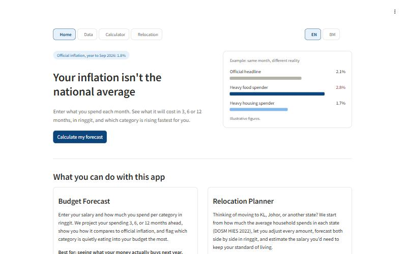
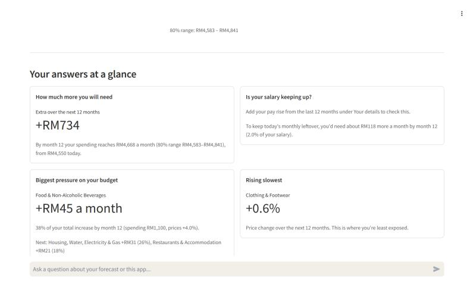
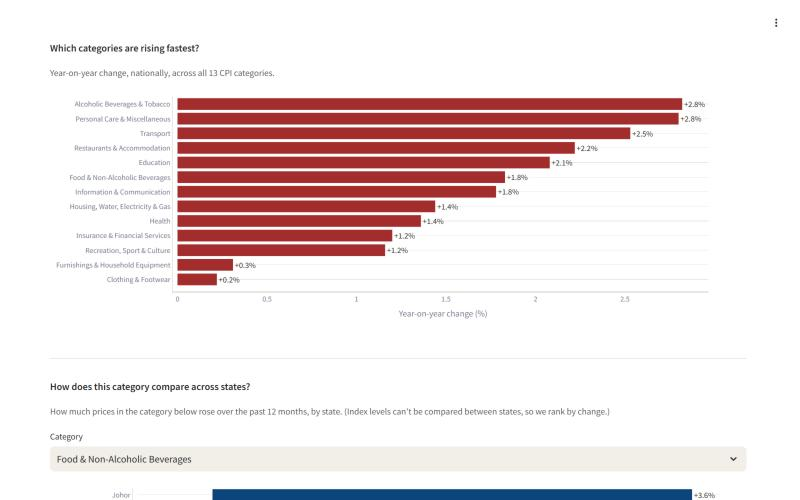
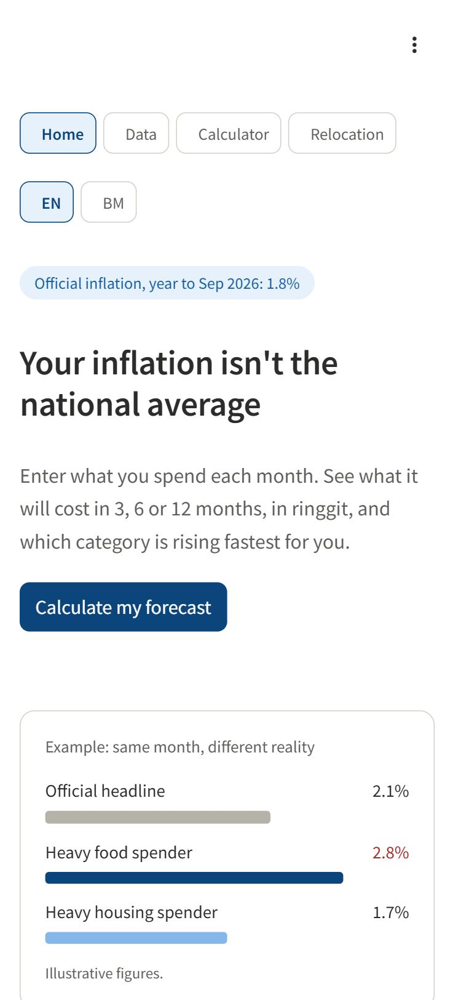

# Real Ringgit

*Personal inflation forecasts for Malaysia*

**Official inflation is one national number. Yours depends on what you spend.** This system forecasts Malaysian CPI by state and category from official DOSM and BNM data, refreshes itself every month, and turns it into a personal forecast in ringgit, in English and Bahasa Malaysia.

[**Live app**](https://inflation-app-lxxpkjdxja-as.a.run.app) · [API docs](https://inflation-api-lxxpkjdxja-as.a.run.app/docs) · [Case study: my model was 97% accurate, until I tested it properly](docs/case-study.md)

<p align="center">
  
  
</p>
<table align="center">
  <tr>
    <td></td>
    <td></td>
  </tr>
</table>

## Highlights

- **Forecasts that were tested honestly.** The first model reported 97% directional accuracy. A rolling-origin backtest showed that was leakage, and the model lost to "prices stay the same" at every horizon (up to 2.2 times the error at one month). The redesigned ETS + XGBoost average beats that baseline by 6% at 6 and 12 months (10 to 21% at 3 to 12 months since 2022), and its 80% ranges held 81% of the time out of sample. Every forecast the system publishes is later scored against what actually happened, live at `/forecast-accuracy`.
- **A monthly pipeline that runs itself.** Cloud Scheduler starts a Cloud Run Job: ingest DOSM and BNM data, build it with dbt (23 data tests), train, calibrate, publish. The infrastructure is defined in Terraform.
- **A chatbot that fetches numbers instead of guessing.** Retrieval over a curated knowledge base, plus four forecast tools the model can call. Evaluated on 30 questions in three layers: retrieval, tool choice, and judged answer quality. [How it works](docs/chatbot.md)
- **Privacy as a design decision.** I first logged every chat question, then removed it. Only my own evaluation runs are recorded; users' questions and answers are never stored.
- **Production habits.** Keyless CI sign-in (Workload Identity Federation), one least-privilege service account per job, about 160 fast tests and a linter on every pull request, pinned container images, rate limits and a budget alert.

## The Problem

Malaysia's official CPI is a single national average. A person in Kelantan spending 45% of income on food experiences completely different inflation to a professional in KL spending 30% on housing. This project makes that gap visible, quantifiable, and personal — using real DOSM and BNM data, refreshed automatically every month.

---

## What It Does

**Personal budget forecast.** Enter your salary and what you really spend per category, in ringgit. You get your **personal inflation over the past 12 months** next to the official rate over the same period (like-for-like), then a 3, 6 or 12-month forecast per category with backtest-calibrated 80% ranges. A "Quick estimate" button starts from your state's average household, so a first result takes two clicks. An AI-written budgeting suggestion is available on request, grounded in your own numbers.

**Relocation planner.** Compare the cost of living between any two Malaysian states. Destination spending starts from the difference in average household spending (DOSM HIES 2022) and is fully editable. Each state's prices are then forecast forward, with a salary-needed estimate. (It deliberately doesn't divide one state's CPI index by another's: index levels measure change since a base period, not how expensive a state is.)

**Data explorer.** A national overview (headline inflation, category leaderboard, state leaderboard), then historical CPI, PPI and interest-rate trends for any state and category, with real policy events marked (for example the 2024 SST increase and the 2024 targeted diesel subsidy).

**Ask anything.** A chat box on the forecast pages. It answers how the app works from a retrieval knowledge base, and fetches live forecast numbers with tools when a question needs them. It never invents figures, and what people type is not stored.

---

## Key Results

> 📖 **[Case study: my model was 97% accurate, until I tested it properly](docs/case-study.md)**: how the original metrics turned out to be leakage, how an honest backtest showed the model losing to "no change", and how the redesign fixed it.

Forecasts are evaluated with a **rolling-origin backtest** (`ml/training/backtest.py`). For every month from Jan 2018 to Jul 2026, every model is retrained using only the data available at that date. It then forecasts 1–12 months ahead for all 16 states × 13 categories and is scored against what actually happened. A self-test corrupts all future data and confirms no model's forecast changes.

**Error relative to the naive forecast ("prices stay where they are")**: below 1.00 beats naive.

| Model | 1 month | 3 months | 6 months | 12 months |
|---|---:|---:|---:|---:|
| Naive (no change) | 1.00 | 1.00 | 1.00 | 1.00 |
| Trend continues (12-month drift) | 1.17 | 1.17 | 1.18 | 1.18 |
| ETS per series | 1.06 | 1.01 | 0.99 | 0.96 |
| **XGBoost, direct growth model** | 1.04 | 0.97 | 0.95 | 0.99 |
| **ETS + XGBoost average** | 1.03 | **0.97** | **0.94** | **0.94** |
| XGBoost, original design (replaced) | 2.23 | 1.37 | 1.22 | 1.11 |

Since 2022, the ETS + XGBoost average is 10–21% more accurate than naive (0.97 / 0.90 / 0.86 / 0.79). It also gets the direction of price change right 70–77% of the time. No model reliably beats naive one month ahead: about 40% of month-to-month category changes are exactly zero.

**What changed and why.** The original model reported MAE 0.73 and 97% directional accuracy, but those numbers didn't reflect real forecasting:
- **Leakage.** Its moving-average features included the month being predicted (fixed in the dbt mart).
- **Wrong test.** It was only tested one step ahead, while the app forecasts recursively up to 12 months.
- **Mixed-up direction metric.** Directional accuracy compared neighbouring rows from different series.

Under an honest backtest it was about 2× worse than naive. The redesign:
- predicts the **% change over each horizon**, with a separate model per horizon, instead of feeding predictions back in;
- tells the model **which state and category** each series is;
- adds **price stickiness**, **cross-state category trends** and **last year's same-period change** as features;
- trains on **absolute error**, which is what it is scored on.

**Live track record.** A backtest is still a reconstruction. So every month the pipeline also scores **every forecast it actually published** against the CPI DOSM has released since. It reports error against "no change" and how often the 80% range held, by horizon. Nothing in this scorecard could have been seen when the forecast was made. It's published to `forecasts/scorecard.json` and served at `GET /forecast-accuracy`, and it fills in as published forecasts reach their target months.

Full tables by period and metric: `docs/backtest_report.md`.

**RAG evaluation** (22 questions against the live API, 11 Nov 2026; every question was judged). This run predates tool calling: the 8 data questions and the tool choice metric were added afterwards and have no published score here yet.

| Metric | Score | Questions |
|---|---:|---:|
| Retrieval hit rate (no LLM) | 1.00 | 19 |
| Retrieval MRR (no LLM) | 0.94 | 19 |
| Faithfulness | 1.00 | 22 |
| Answer relevancy | 1.00 | 19 |
| Context precision | 1.00 | 19 |
| Correctness | 0.99 | 19 |
| Refusal (out-of-scope questions) | 1.00 | 3 |

Correctness was 0.99 in English (15 questions) and 1.00 in Bahasa Malaysia (4).

How to read this: the two retrieval rows are exact counts and the most trustworthy. The judge-scored rows are near their ceiling, which says as much about the test as about the chatbot: the knowledge base is small (27 entries), the questions map closely onto it, and the judge was the same model family that wrote the answers. They work as a regression gate (a broken prompt or stale knowledge base would show up) more than as a measure of how good the chatbot is. Harder questions and a stronger, different judge model are the next step. The latest numbers are on the "Evaluate chatbot answers" workflow's Summary page.

---

## Architecture

```
data.gov.my / OpenDOSM
        │
        ▼
[ingestion/ingest.py]  ←── Python, requests, pandas
        │  Download parquet → validate → upload to GCS → load to BigQuery (WRITE_TRUNCATE)
        ▼
[GCS raw bucket]  ←── Versioned + latest copies of every raw file
        │
        ▼
[BigQuery raw dataset]  ←── Exact DOSM/BNM schema, no transformation
        │
        ▼
[dbt transform layer]  ←── 7 staging views + 2 mart tables, 23 data quality tests
        │  Staging: type casting, null filtering, income band classification
        │  Mart: lag features (1/3/6/12mo), rolling averages (3/12mo), PPI leads, OPR
        ▼
[BigQuery mart dataset]  ←── mart_cpi_features (43,900+ rows), mart_income_bands
        │
        ├──────────────────────────────────────────────┐
        ▼                                              ▼
[ml/training/forecast_batch.py]           [Cloud Scheduler]
  ETS + direct-growth XGBoost average,       (cron: 3rd of every month)
  80% ranges from backtest errors                   │
  forecasts/latest.json saved to GCS                ▼
        │                              [Cloud Run Job: inflation-data-pipeline]
        │                                (ingest.py → dbt run → dbt test → forecast_batch.py)
        ▼
[ml/serving/api.py]  ←── FastAPI, forecast table + FAISS index loaded from GCS (table re-checked hourly)
        │  /forecast, /forecasts — 3/6/12-month CPI forecast with 80% range (one or many categories)
        │  /trends              — historical CPI/PPI/OPR time series
        │  /category-leaderboard, /state-leaderboard — national/state rankings
        │  /forecast-accuracy   — live track record of published forecasts
        │  /ask                 — RAG-grounded Q&A (Gemini + FAISS)
        │  /prescriptive-insight — AI-generated general budgeting suggestion
        ▼
[app/streamlit/app.py]  ←── Bilingual (EN/BM) citizen-facing app, Plotly charts
        │
        ▼
[Cloud Run]  ←── Both services containerised with Docker, deployed via Terraform + GitHub Actions
```

---

## Engineering

### The chatbot

`/ask` retrieves from a 27-entry knowledge base on every question, then lets the model call one of four tools (`get_forecast`, `rank_categories`, `rank_states`, `get_forecast_accuracy`) when it needs forecast numbers. Plain Gemini function calling, no agent framework: capped at 2 rounds and 6 tool calls, tools never raise, and every argument is validated. It is scored by a custom Gemini-based judge harness that runs on demand, because a run uses about 60 to 100 requests on the key the live chatbot shares. Full design, evaluation method and the decisions behind it: **[docs/chatbot.md](docs/chatbot.md)**.

### Tests

```bash
pip install pytest ruff
pytest -m "not slow"      # API + forecasting unit tests, a few seconds
pytest                    # also trains real models on synthetic data (~2 min)
ruff check .
cd app/streamlit && python -m unittest test_budget test_user_profile test_ui_logic test_api_cache test_navigation
```

- `tests/api/` exercises every API endpoint's validation, the precomputed-forecast lookups, the scorecard, the chatbot's tool loop and the logging rules. Retrieval and Gemini are faked, so no key or GCP access is needed.
- `tests/evaluation/` checks the chatbot evaluation harness itself: judge-reply parsing, retrieval and tool-choice metrics, the pass / fail / incomplete verdict, and that every test question points at a knowledge-base entry that exists.
- `tests/training/` covers the forecast ranges, the live scorecard arithmetic, the baseline forecasters, the backtest metrics, and the moving-average leak that the original model had. Two slow tests train real models: the **leakage self-test** (multiply all data after the forecast date by 50; no forecast may change) and an end-to-end run of the monthly batch.
- `app/streamlit/test_*.py` covers the budget maths, saved profiles, the cache wrapper, and navigation. The navigation tests run the whole app through Streamlit's own test tool and exist because two real bugs (a cache-key collision and a page reset on deep links) got past manual checks.

All of this runs on every pull request (`.github/workflows/`) with the same pinned requirements as the production images.

### Deployment

Infrastructure is fully defined in Terraform, including Secret Manager-backed API keys and the automated monthly pipeline. CI/CD via GitHub Actions runs automatically on push to `main` when `ml/serving/` or `app/streamlit/` files change, and dynamically fetches each service's real deployed URL rather than guessing it — self-correcting if Cloud Run's URL format ever changes.

```bash
cd infra/terraform
terraform apply -var="alert_email=you@example.com"   # emails you if the monthly pipeline fails
```

All three images use **fully pinned** requirements (every transitive dependency), and every pull request builds and smoke-tests them (`.github/workflows/pr-build.yml`). An unpinned rebuild once broke the Streamlit app (pyarrow vs NumPy). The pinned pipeline environment was also how a missing `scikit-learn` in the pipeline image was caught.

### Security and access

**Access.** GitHub Actions signs in to Google Cloud without a stored key (Workload Identity Federation): GitHub issues a short-lived token for each run, and Google accepts it only from this repository's `main` branch. Each identity has one job and only the access that job needs:

| Identity | Used by | Can |
|---|---|---|
| `github-deployer` | GitHub Actions | push images to one repository, deploy revisions, update the pipeline job |
| `vertex-sa` | API | read the ML artifacts bucket and BigQuery, write the LLM log table, read two secrets |
| `streamlit-app-sa` | Streamlit app | nothing: it only calls the API over HTTPS |
| `ingestion-sa` | monthly pipeline job | write two buckets, load and transform BigQuery data |
| `pipeline-scheduler-sa` | Cloud Scheduler | start the one pipeline job |

All of it is defined in `infra/terraform/iam.tf`.

- **Rate limiting** — 30 req/min on data endpoints, 15 req/min on LLM-touching endpoints (`/ask`, `/prescriptive-insight`), enforced via `slowapi`, verified with a 35-request burst test
- **Input validation** — state/category parameters checked before any BigQuery query runs
- **GCP budget alert** — configured with alerts at 50/90/100% of monthly threshold
- **Cloud Run scaling caps** — hard ceiling on concurrent compute regardless of traffic (max 3 API instances, 2 app instances)
- **Secrets** — Gemini API key stored in Secret Manager, injected at runtime, never in plaintext Terraform

### Resource identifiers

| Resource | Value |
|---|---|
| Project ID | modular-rush-495414-i2 |
| Region | asia-southeast1 (Singapore) |
| API service | inflation-api (Cloud Run) |
| App service | inflation-app (Cloud Run) |
| Data pipeline job | inflation-data-pipeline (Cloud Run Job) |
| Pipeline schedule | 3rd of every month, 03:00 UTC (Cloud Scheduler) |

---

## Tech Stack

| Layer | Tools |
|---|---|
| Infrastructure | Terraform, Google Cloud Platform |
| Storage | Google Cloud Storage (GCS), BigQuery, Secret Manager |
| Ingestion | Python, pandas, requests, google-cloud-bigquery |
| Transformation | dbt, SQL (BigQuery dialect) |
| ML Training | XGBoost, statsforecast (AutoETS), scikit-learn |
| GenAI / RAG | Gemini API (gemini-embedding-001, gemini-3.1-flash-lite), FAISS |
| Serving | FastAPI, uvicorn, slowapi (rate limiting) |
| Frontend | Streamlit (bilingual EN/BM), Plotly |
| Automation | Cloud Scheduler, Cloud Run Jobs |
| Deployment | Docker, Cloud Run, Artifact Registry |
| CI/CD | GitHub Actions |
| Auth | Workload Identity Federation (keyless CI), one service account per job, Secret Manager |

---

## Data Sources

All data is publicly available from the Malaysian government with no authentication required, and refreshed automatically every month via a scheduled Cloud Run Job.

| Dataset | Source | Rows | Frequency |
|---|---|---|---|
| CPI by State (13 divisions × 16 states) | DOSM / data.gov.my | 43,900+ | Monthly |
| CPI National (headline + by division) | DOSM / data.gov.my | 7,700+ | Monthly |
| Producer Price Index (PPI) | DOSM / data.gov.my | 575+ | Monthly |
| PPI by SITC | DOSM / data.gov.my | 5,175+ | Monthly |
| Household Income & Expenditure (HIES) | DOSM / data.gov.my | 16 | Survey (2022 edition) |
| Bank interest rates (commercial banks' base rate; this dataset has no OPR series) | BNM / data.gov.my | 5,700+ | Monthly |

---

## Project Structure

```
malaysia-inflation-intel/
├── infra/terraform/           # GCP infrastructure as code
│   ├── main.tf, storage.tf, bigquery.tf, iam.tf
│   ├── cloudrun.tf             # API + Streamlit services, Secret Manager wiring
│   └── scheduler.tf            # Cloud Run Job + Cloud Scheduler (monthly pipeline)
├── ingestion/
│   ├── ingest.py, config.py, requirements.txt
│   ├── run_pipeline.sh         # ingest → dbt run → dbt test → forecast_batch, for the scheduled Job
│   └── Dockerfile
├── transform/dbt_project/
│   └── models/{staging,mart}/
├── ml/
│   ├── training/
│   │   ├── backtest.py          # rolling-origin backtest, models, leakage self-test
│   │   └── forecast_batch.py    # monthly: train, calibrate ranges, publish forecasts + scorecard
│   └── serving/
│       ├── api.py               # FastAPI entry point and the data endpoints
│       ├── service/
│       │   ├── config.py            # settings, states, categories, rate limiter
│       │   ├── data.py              # every BigQuery query
│       │   ├── forecasts.py         # precomputed forecast table + scorecard
│       │   ├── chat.py              # /ask and /prescriptive-insight
│       │   ├── chat_tools.py        # the tools the chatbot can call
│       │   └── llm_log.py           # LLM call logging (evaluation traffic only)
│       ├── rag/
│       │   ├── knowledge_base.py    # 27 hand-curated entries
│       │   ├── build_index.py       # embeds corpus → FAISS index → GCS
│       │   └── retriever.py         # loads index, embeds queries, searches
│       ├── Dockerfile, requirements.txt
├── evaluation/
│   ├── test_questions.py        # versioned RAG evaluation test set
│   ├── scorer.py                # custom Gemini LLM-as-judge: one call per question, strict JSON parsing
│   ├── run_eval.py               # runner: retrieval metrics, judge, results files, CI gate
│   └── knowledge_base_mirror.py  # mirrors the real knowledge base for scoring context
├── app/streamlit/
│   ├── app.py                   # bilingual UI: Home, Data, Calculator, Relocation
│   ├── budget.py, user_profile.py, household_spending.py   # budget maths, saved profiles, HES 2024 averages
│   ├── ui_logic.py, api_cache.py                           # small helpers, kept testable
│   ├── test_*.py                # app unit tests, including whole-app navigation tests
│   ├── Dockerfile, requirements.txt
├── tests/{api,evaluation,training}/   # pytest suites, run on every pull request
├── docs/                        # case study, backtest report, chatbot design, screenshots
└── .github/workflows/
    ├── tests.yml                 # lint + unit tests on every PR
    ├── terraform.yml             # validate Terraform on every PR
    ├── pr-build.yml              # build + smoke-test all three images on every PR
    ├── pipeline-image.yml        # build + push the monthly pipeline image
    ├── deploy.yml                # build + push + deploy on merge to main
    └── rag-eval.yml              # chatbot evaluation, run on demand
```

---

## Running Locally

### Prerequisites
- Python 3.11+ (API/app), Python 3.12 (Docker base image)
- GCP project with BigQuery, GCS, Secret Manager access
- `gcloud auth application-default login`
- dbt with BigQuery adapter: `pip install dbt-bigquery`
- A Gemini API key from [aistudio.google.com/apikey](https://aistudio.google.com/apikey)

### 1 — Ingest data
```bash
cd ingestion
pip install -r requirements.txt
python ingest.py
```

### 2 — Run dbt transformations
```bash
cd transform/dbt_project
dbt run
dbt test
```

### 3 — Train and publish forecasts
```bash
cd ml/training
python forecast_batch.py                      # trains, calibrates ranges, uploads forecasts/latest.json to GCS
# offline: python forecast_batch.py --source files --data-dir ../../data --local-out forecasts.json
```
This runs automatically every month as step 4 of the pipeline job. The API only serves the published table; no model runs inside it.

### 4 — Build the RAG index (one-time, or after editing knowledge_base.py)
```bash
cd ml/serving/rag
export GEMINI_API_KEY="your-key"
python build_index.py
```

### 5 — Start the API
```bash
cd ml/serving
export GEMINI_API_KEY="your-key"
uvicorn api:app --reload --port 8081
# or serve a local forecast file: FORECAST_LOCAL_PATH=../training/forecasts.json uvicorn api:app --port 8081
```

### 6 — Start the Streamlit app
```bash
cd app/streamlit
pip install -r requirements.txt     # pinned: Streamlit 1.37
API_URL=http://localhost:8081 streamlit run app.py
```

Open [http://localhost:8501](http://localhost:8501).

### 7 — Run the RAG evaluation harness (optional)
```bash
cd evaluation
export GEMINI_API_KEY="your-key"
export API_URL=http://localhost:8081
python run_eval.py
```

---

## Known Issues / Engineering Notes

- **RAGAS dependency conflict.** The standard RAG evaluation library `ragas` (both 0.4.3 and 0.3.9) hit an unpatched upstream bug — `ragas.llms.base` imports `ChatVertexAI` from a `langchain_community` path that was relocated upstream, confirmed via the library's own GitHub issues (#2741, #2745). The documented workaround (pinning `langchain-community==0.2.17`) then surfaced a separate, unrelated `numpy==1.26.4` binary incompatibility on Python 3.13/Windows. Rather than continue chasing a fragile dependency chain, `evaluation/scorer.py` implements the same LLM-as-judge approach directly on the Gemini API.
- **Category-specific causal reasoning.** The `/ask` endpoint can explain *how* a metric like "biggest leak" is calculated, but doesn't yet have per-category economic narratives explaining *why* a specific category (e.g. Transport) is moving the way it is, beyond general model mechanics. Documented in `knowledge_base.py` as `category_specific_causes_limitation`.
- **State-level granularity.** CPI and price data are reported at the state level, not district/city level — DOSM's district-level "Decent Living Expenditure Index" (released Dec 2025) is a logged future improvement, not yet integrated.
- **Forecast ranges are pooled across categories.** The 80% ranges come from the last 36 months of backtest errors. In an out-of-sample test, ranges built from Aug 2020–Jul 2023 covered 81% of outcomes from Aug 2023 onward. Per-category ranges were tested but overfit (62–72% coverage), so every category currently gets the same % width at a given horizon.
- **Cold starts.** The API scales to zero to keep costs near nothing, and a cold start takes about 20 seconds. The app wakes it with one cheap background request when a visitor first opens the page, so most visitors never wait, but one who lands directly on the Data page after a long idle period can.
- **Short-horizon forecasts are inherently weak.** Monthly CPI is sticky, and even the best model only modestly beats "no change" at 1–3 months. Forecasts should be presented with that uncertainty.

---

## Roadmap

- Budget advisor that reasons over the user's own spending figures (the chatbot already calls forecast tools; this would add the user's budget as a tool)
- Content-free latency and error metrics for real chat traffic (evaluation calls are already logged)
- Automated model retraining gate — compare newly retrained models against the deployed one before promotion
- Prediction logging for real-world drift monitoring
- District-level cost-of-living integration (DOSM PAKW dataset)

---

## Author

**Muhammad Ammar Ahmad Zaki** — Computer Science and AI graduate, George Town, Penang.
· [Email](mailto:ammarzaki160802@gmail.com)

---

*Data sourced from [data.gov.my](https://data.gov.my) and [OpenDOSM](https://open.dosm.gov.my). Published under the terms of the Malaysian Open Data initiative.*

Code licensed under the [MIT License](LICENSE).
